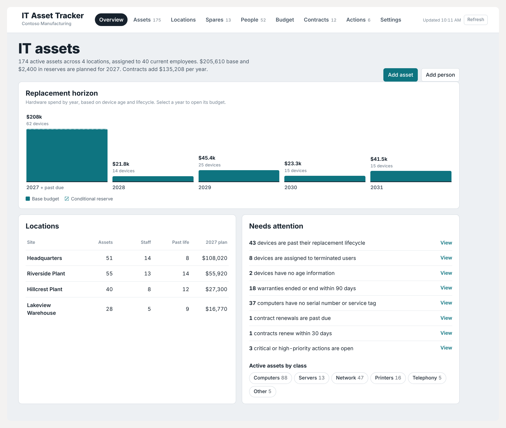

# IT Asset Tracker for SharePoint

A free SharePoint Online web part for small and mid-size IT teams that tracks every device, who has it,
where it lives, and when it needs replacing - and turns that into a multi-year replacement budget.
Everything is stored in ordinary SharePoint lists on your own site. No servers, no database, no subscription.



## Features

- **Assets** - computers, servers, network gear, printers, phones, circuits. Sort, filter, search by name,
  model, user, serial or IP. Multi-select and bulk edit.
- **Needs attention** - devices past their lifecycle, out of warranty, missing a serial, or still assigned to
  someone who has left.
- **People** - staff with their assigned equipment. Add a person and their devices in one step.
- **Locations** - a page per site with its people, devices, spares and open actions.
- **Spares** - what's on the shelf at each site, how long it's been there, and which classes are below the
  minimum you set.
- **Device history** - dated notes, repairs, reimages and assignment history, plus SharePoint version history.
  Repurpose a device (reassign and rename) without losing its history.
- **Replacement budget** - next year and five years out, grouped by replacement class, using each class's
  unit cost and lifecycle. Per-device overrides (replace / reserve / skip, plan year, quoted price).
  Optional prompt to review the plan with Microsoft Copilot.
- **Contracts** - subscriptions, support renewals, circuits and leases with renewal dates and costs; recurring
  costs flow into the budget.
- **IT actions** - a simple to-do list by site and priority.
- **Printable reports** - asset lists, site and person sheets, equipment hand-off form with signature lines,
  spares, budget and contracts.
- Light and dark themes, works on phones.

More screenshots are in the [screenshots](screenshots/) folder (all made with fictional demo data).

## What's in this release

| Path | What it is |
|---|---|
| `it-asset-tracker.sppkg` | The web part package to upload to your App Catalog |
| `scripts/Install-AssetTracker.ps1` | Creates the SharePoint lists (and optional demo data). Safe to re-run |
| `scripts/Import-Assets.ps1` | Imports people and assets from CSV |
| `templates/` | CSV templates for the import |
| `sample-data/` | Fictional demo company ("Contoso Manufacturing") used by `-SampleData` |
| `screenshots/` | Screenshots of every page |
| `source/` | SPFx source code (SharePoint Framework 1.23) |

## Requirements

- SharePoint Online (Microsoft 365) and a site to hold the lists - an IT team site works well.
- SharePoint admin (or App Catalog) rights to upload the package once.
- Site Owner rights on the target site.
- PowerShell 7.4+ with [PnP.PowerShell](https://pnp.github.io/powershell/):
  `Install-Module PnP.PowerShell -Scope CurrentUser`
- A PnP sign-in app registration in your tenant (one time). If you don't have one:
  `Register-PnPEntraIDAppForInteractiveLogin -ApplicationName "PnP PowerShell" -Tenant <tenant>.onmicrosoft.com`
  and note the Client ID it prints.

## Install

1. **Create the lists.** Run on any PC (Unblock-File the scripts first if Windows blocks them):

   ```powershell
   ./scripts/Install-AssetTracker.ps1 -SiteUrl https://<tenant>.sharepoint.com/sites/it -ClientId <client-id> `
       -Locations "Headquarters","Plant 2","Warehouse"
   ```

   This creates seven lists (prefixed `IT `): Locations, Replacement Classes, People, Assets, Actions,
   Asset Log and Contracts. Replacement classes start with example costs and lifecycles - adjust them in the
   app's **Settings** page. Want to try it first? Use a test site and add `-SampleData`.

2. **Upload the app.** In the SharePoint admin center, open **More features > Apps > App Catalog**, upload
   `it-asset-tracker.sppkg`, and choose to make it available (tenant-wide deployment is fine; it only shows
   where you add it).

3. **Add it to a page.** On the site, create a page, add the **IT Asset Tracker** web part, and in its
   settings set the **title** and your **organization name**. Publish the page. Full-width section recommended.

4. **Add your data.** Enter devices in the app, paste rows into the lists with *Edit in grid view*, or import
   CSVs:

   ```powershell
   ./scripts/Import-Assets.ps1 -SiteUrl https://<tenant>.sharepoint.com/sites/it -ClientId <client-id> `
       -PeopleCsv .\People.csv -AssetsCsv .\Assets.csv -WhatIf     # preview, then run without -WhatIf
   ```

   Missing locations and people are created; rows whose serial (or name) already exists are skipped, or
   updated with `-Update`.

## Web part settings

| Setting | Default | Notes |
|---|---|---|
| Title | IT Asset Tracker | Shown in the app header |
| Organization name | (blank) | Shown under the title and used in the budget review prompt |
| List name prefix | `IT ` | Must match `-Prefix` used with the install script. Lets you run more than one tracker on a site |
| Theme | Light | Light or dark |

## Permissions and data

The web part runs as the signed-in user and reads and writes the lists with that user's SharePoint
permissions. Give IT staff **Edit** on the lists, and keep everyone else out (break inheritance on the
lists or use a private IT site). Your data stays in your SharePoint lists and is never sent anywhere else. The
only outside requests are a web font from Google Fonts, plus the price-search and Copilot buttons, which open
those sites in a new tab when you click them.

## Upgrading

Upload the new `.sppkg` over the old one in the App Catalog. If a release adds list columns, run
`Install-AssetTracker.ps1` again - it only adds what's missing and never deletes anything. The Settings page
shows whether every expected column was found.

## Building from source

```bash
cd source
npm install
npm run build        # produces sharepoint/solution/it-asset-tracker.sppkg
```

Requires Node.js 22 LTS. The app itself is in `src/webparts/assetTracker/app/` (framework-free TypeScript);
`AssetTrackerWebPart.ts` mounts it and passes the web part settings.

## License

MIT - see [LICENSE](LICENSE). Provided as-is, without warranty.
